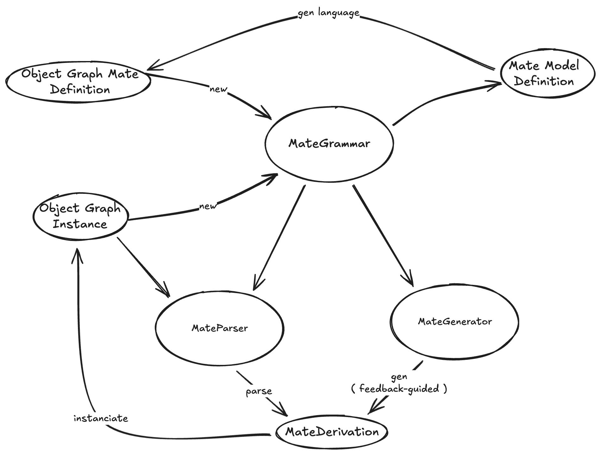

<p align="center">
  
</p>

<p align="center">
  <a href="https://github.com/FedeLoch/Mate/actions/workflows/ci.yml"></a>
  <a href="https://github.com/FedeLoch/Mate"></a>
  <a href="https://github.com/FedeLoch/Mate"></a>
</p>

# Mate - Object Graph Language

Mate is an object graph language implementation that allows you to define grammars representing software system structures and generate valid object instances from those grammars. To know more about Mate:

- [Mate Language](https://github.com/FedeLoch/Mate/wiki/Mate-Language)
- [Mate Grammar Examples](https://github.com/FedeLoch/Mate/wiki/Grammar-Examples)
- [How Mate Works](https://github.com/FedeLoch/Mate/wiki/How-Mate-Works)
- [Derivation Model](https://github.com/FedeLoch/Mate/wiki/Derivation-Model)
- [Object Graph Fuzzing](https://github.com/FedeLoch/Mate/wiki/Fuzzing)
- [Object Graph Parsing](https://github.com/FedeLoch/Mate/wiki/Parsing)
- [Object Graph Type Validation](https://github.com/FedeLoch/Mate/wiki/Object-Graph-Type-Validation)
- [Dynamic Grammar Generation by Test Suites](https://github.com/FedeLoch/Mate/wiki/Dynamic-Grammar-generation-by-Test-Suites)

## Architecture Overview

Mate is built on a systematic, grammar-driven framework that decouples structural definitions from object instances or Mate definitions, enabling the generation of complex, state-consistent object graphs. It employs a feedback-oriented derivation process, in which the object grammar productions are iteratively refined using any metric.



With Mate, you can:
- Declare your own Object Graph Grammars
- Generate valid object instances from a grammar and historical reward ( Monte Carlo Tree Search )
- Mate Object Graphs derivations visualization
- Propagate rewards through the derivation tree to improve future generations
- Parse and validate object graphs against your Mate grammar
- Generate Mate Object graph Grammar definitions from test object suites

## Quick Start

```Smalltalk
Metacello new
    baseline: 'Mate';
    repository: 'github://FedeLoch/Mate:main';
    onConflictUseIncoming;
    load.
```

The default group loads the `Mate` package only. The paper experiments (including the Moose grammar, which needs Moose loaded in the image) live in the `Mate-Experiments` package:

```Smalltalk
Metacello new
    baseline: 'Mate';
    repository: 'github://FedeLoch/Mate:main';
    onConflictUseIncoming;
    load: 'experiments'.
```

## Examples


### Person Object Graph Grammar:

```smalltalk
Person -> { age: Age }
Age -> { value: SmallInteger }
```

Generating Person instances:

```smalltalk
grammar := MatePersonGrammar new.
person := grammar gen: Person.

person age.  "=> a SmallInteger, biased toward boundary values such as 0, -1 or SmallInteger maxVal"
```

### Player Object Graph Grammar:

```smalltalk
Player -> {
  name: ByteString,
  characterClass: Warrior | Rogue | Mage,
  level: { type: SmallInteger, between: 0 and: 99 },
  missingExperienceForNextLevel: { type: SmallInteger, greaterThan: 0 }
}
```

Generating player instances:

```smalltalk
grammar := MatePlayerGrammar new.
player := grammar gen: Player.

player name.            "=> 'xyz123'"
player characterClass.  "=> a Warrior"
player level.           "=> 47 (always 0-99)"
player missingExperienceForNextLevel.  "=> always > 0"
```

`greaterThan:` and `lessThan:` exclude the bound, `atLeast:`, `atMost:` and `between:and:` include it.

### Bloc Element Object Graph Grammar

```smalltalk
BlElement -> {
  children: BlChildrenArray,
  parent: { refType: BlElement },
  visuals: (BlCustomVisuals | BlDefaultVisuals),
  constraints: BlLayoutCommonConstraints,
  selfReferences: { children.array[ .parent ] }
}

BlChildrenArray -> { 
  array: { type: [ BlElement ], sizeBetween: 0 and: 10 }
}

BlCustomVisuals -> { 
  background: (BlPaintBackground | BlTransparentBackground),
  geometry: (BlRectangleGeometry | BlEllipseGeometry | BlTriangleGeometry),
  clipChildren: Boolean,
}

BlLayoutCommonConstraints -> {
  position: Point,
  vertical: BlLayoutCommonConstraintsAxis,
  horizontal: BlLayoutCommonConstraintsAxis
}

BlLayoutCommonConstraintsAxis -> {
  resizer: BlLayoutExactResizer
}

BlLayoutExactResizer -> {
  size: { type: SmallFloat64, between: 100 and: 1000 }
}

BlPaintBackground -> {
  paint: BlColorPaint
}

BlColorPaint -> {
  color: Color
}

BlTriangleGeometry -> {
  orientation: { oneOf: { #top . #right . #left . #bottom } }
}
```

Generating Bloc Element instances:

```smalltalk
grammar := MateBlocGrammar new.
element := grammar gen: BlElement.
```

### Object Graph Derivation Visualization

```smalltalk
grammar := MateBlocGrammar new.
derivationTree := grammar gen: BlElement from: MateContext new.
derivationTree render
```


### Fuzzing Backpropagation

Propagate rewards through the derivation tree to improve future generations:

```smalltalk
grammar := MatePlayerGrammar new.
derivationTree := grammar gen: Player from: MateContext new.
player := derivationTree instance.

"Propagating feedback for future generations"
grammar backpropagate: derivationTree improvement: 42.
```

## Mate Language Reference

```smalltalk
"Comments are written between double quotes"
Example -> {
  count: SmallInteger,
  ratio: { type: Float, between: -0.5 and: 1.5e2 },
  positive: { type: SmallInteger, greaterThan: 0 },
  limit: { type: SmallInteger, atLeast: 1, atMost: 10 },
  code: { type: SmallInteger, in: [ 200, 404, 500 ] },
  label: ByteString?,
  optionalCount: { type: SmallInteger, atLeast: 0, nullable: true },
  shape: (BlEllipseGeometry | BlTriangleGeometry)?,
  kind: { oneOf: { #small . #large . 'text' . 42 . -1 . true . nil } },
  species: OrderedCollection class | Set class,
  items: { type: [ SmallInteger | ByteString ], sizeBetween: 0 and: 5 },
  pair: { type: [ Point ], size: 2 },
  owner: { refType: Example },
  selfReferences: { items[ .owner ] }
}
```

| Construct | Meaning |
| --- | --- |
| `A \| B` | Union of types, flattened and printed in alphabetical order |
| `T?` / `nullable: true` | The field may be generated as `nil` (see `nilProbability:`) |
| `between: a and: b`, `atLeast:`, `atMost:` | Inclusive numeric bounds |
| `greaterThan:`, `lessThan:` | Exclusive numeric bounds |
| `in: [ ... ]` | The value is one of the listed literals |
| `oneOf: { ... }` | The field is one of the listed literals (symbols, strings, numbers, booleans, `nil`, classes) |
| `[ T ]` with `sizeBetween: a and: b` or `size: n` | Array of `T`; without a size it defaults to `sizeBetween: 0 and: 10` |
| `refType: T` | Reference filled by a `selfReferences` path, not generated |
| `X class`, `X classTrait` | Metaclass types |

Identifiers may contain letters, digits and `_`. Numbers may be negative and use decimals or exponents. Malformed input raises an error that includes the position where parsing failed.

## Fuzzing

### Reproducible generation

Every generator draws from a single random generator owned by the grammar, so a seed replays the same sequence of objects:

```smalltalk
grammar := MatePlayerGrammar new.
grammar seed: 1234.
players := (1 to: 100) collect: [ :i | grammar gen: Player ].
```

### Built-in values

Built-in generators are biased toward values that tend to expose bugs, and always respect the declared class and constraints:

| Type | Generated values |
| --- | --- |
| `SmallInteger`, `LargePositiveInteger`, `LargeNegativeInteger` | Boundary values (0, ±1, powers of two, 32/64-bit limits, `minVal`/`maxVal`, constraint bounds), small values, and uniform values over the whole range |
| `Float`, `SmallFloat64`, `BoxedFloat64` | 0.0, -0.0, ±1.0, `fmax`, denormals, NaN and ±infinity (only for classes that can hold them), constraint bounds and their neighbours, and values across many magnitudes |
| `ByteString`, `WideString`, `ByteSymbol`, `Character` | Empty, short and long strings with letters, digits, punctuation, control bytes and (for `WideString`) Unicode characters |
| `Point`, `Color`, `Boolean`, `Object`, `UndefinedObject` | Random instances |

### Depth limit and nullable fields

Generation stops at `maxDerivationHeight` (12 by default). At the limit, a field takes a built-in option if its type allows one, otherwise it is set to `nil`. Nullable fields are set to `nil` with probability `nilProbability` (0.1 by default):

```smalltalk
grammar generator maxDerivationHeight: 6; nilProbability: 0.2.
```

### Coverage

```smalltalk
grammar explorationPercentage.          "coverage of the declarations reachable from the grammar's own types"
grammar explorationPercentageFrom: Player.  "coverage of the declarations reachable from Player"
```

## Object Graph Validation

`parse:` checks an object graph against the grammar and returns its derivation tree. It raises an error when a field has the wrong type, an array has the wrong size, a value violates a constraint, or a `selfReferences` path does not hold. It never modifies the object, accepts subclasses of declared types, and terminates on cyclic graphs.

```smalltalk
grammar := MatePlayerGrammar new.
grammar parse: (Player new name: 'Fede'; level: 42; characterClass: Rogue new; missingExperienceForNextLevel: 1).

grammar parse: (Player new name: 'Fede'; level: 500; characterClass: Rogue new; missingExperienceForNextLevel: 1).
"=> Error: Value 500 of type SmallInteger violates MateConstraint( min: 0 max: 99)"
```

## Inferring Grammars from Objects

```smalltalk
grammar := MateOGGrammar fromObjects: { player1 . player2 . player3 }.
grammar mateDefinition.
```

Inference merges the observed classes of each field into unions, merges array element types and size ranges (empty arrays add no evidence), records Booleans as `Boolean`, and records fields that hold classes as `oneOf` choices. The output of `mateDefinition` is sorted by type name and parses back into the same grammar.

